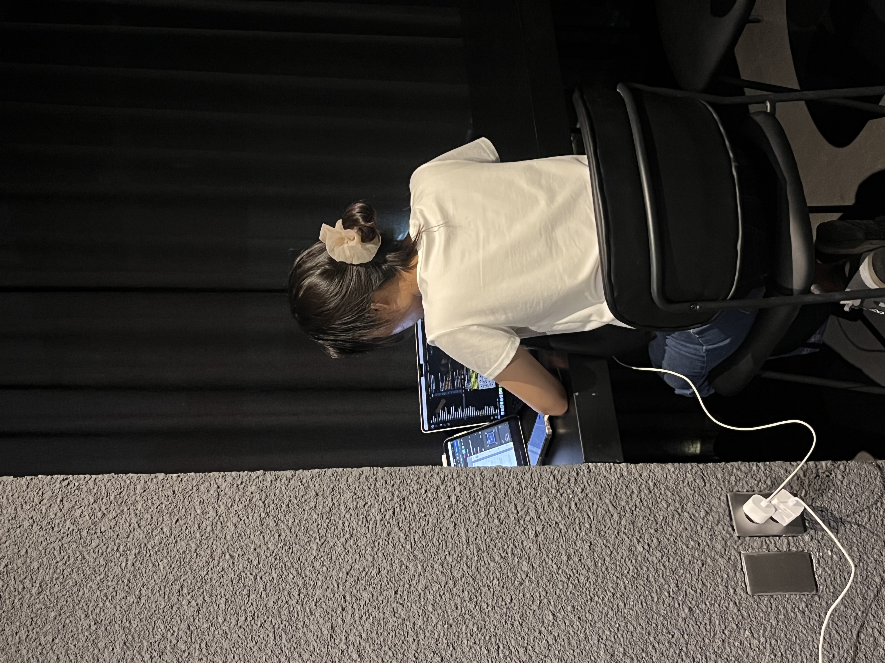

<!-- ═══════ HEADER ═══════ -->

### 안녕하세요, 임예은입니다 👋

 

  

        

 

## 🧳 DUGO — 짐 보관 실서비스

> **`운영 중`** **`단독 개발`** — 카페 유휴공간을 활용한 짐 보관 서비스.
> 한국관광공사 관광벤처(예비창업) **1등 선정팀의 개발자**로, 서비스 웹앱과 브랜드 웹 **2종을 혼자 설계·개발하고 운영**하고 있습니다.

- 🗄️ **DB 설계** — Supabase(PostgreSQL) 테이블 설계, 행 단위 권한 정책(RLS)으로 사용자별 데이터 접근 제어
- 🌏 **핵심 기능** — 짐 보관 등록(사진·QR) · **12개 언어** 다국어 · OAuth 로그인 · PG 온라인 결제(해외카드 포함)
- 💳 **결제 도입 실무** — PG사 심사 대응부터 결제→정산→세금계산서로 이어지는 재무 프로세스 정리까지 직접 수행
- 🔧 **운영 개선** — 결제 전 이탈 시 보관이 확정되는 결함 발견 → 결제 성공 시점에만 확정되도록 상태 전이 수정, 데이터 정합성 확보
- 🤖 **AI 협업 공정** — 설계·판단은 직접, 반복 작업은 AI 에이전트에 위임, 코드 리뷰·실기기 테스트로 검증
- ✅ **성과** — **실사용자 100명** 대상 무장애 운영 중

  

 

## 🌿 쉼표 ShimPyo — 천식 호흡 관리 앱 &nbsp; 🏆 `공학경진대회 은상`

> 스마트폰 마이크로 호기량을 측정해 천식 환자의 호흡을 관리하는 딥러닝 기반 헬스케어 앱 · [Repo](https://github.com/orgs/HSU-shimpyo/repositories)

- 🎨 **역할** — 기획 · 프론트엔드 · **팀 리딩**
- 📈 측정 데이터 차트 시각화와 사용자 흐름 설계 주도
- 🥈 제20회 한성공학경진대회 **은상** (한성대학교, 2024)

  

 

## 🍴 FORK — AR 배달 플랫폼 창업 &nbsp; `대표` `장학생 2곳 선발`

> AR 기반 배달 플랫폼을 직접 창업. 사업자등록부터 MVP까지 대표로서 전 과정을 이끌었습니다 · [Repo](https://github.com/FORK-FE-BE)

- 👑 **역할** — 대표 · 기획 · 프론트엔드
- 🔥 개발 중 팀원 이탈로 서버 코드 유실 → **백엔드 재구축과 역할 재조정으로 MVP 완주**
- 🛡️ 이후 모든 프로젝트에서 버전 관리·백업·권한 분산을 기본값으로 삼는 계기
- 🎓 세아해암학술장학재단 커리어챌린지 장학생 · 한성대 AI/SW 창업장학생 선발

 

 

## 🚗 RecallChecker — 리콜 정보 통합 조회 &nbsp; `팀장` `4일 완성`

> 공공데이터 기반 자동차 리콜 통합 조회 시스템. SK Networks AI Camp 팀 프로젝트 · [Repo](https://github.com/SKNETWORKS-FAMILY-AICAMP/SKN27-1ST-2TEAM)

- 🧭 **역할** — 팀장 · DB 설계 · 백엔드
- ⚡ PostgreSQL 설계, 크롤링 데이터 정제, 조회 대시보드까지 **4일 만에 완성**
- 🐳 Docker로 팀원 간 개발 환경 차이 제거, 역할 분배와 일정 관리 수행

  

 

## 📦 그 외 프로젝트

- 🔭 **[SCOPE](https://github.com/HSU-SCOPE-capstone2025)** — SNS 인플루언서 콘텐츠 멀티모달 분석·지지층 예측 (캡스톤)
- 🧱 **[BLOCKY](https://github.com/BLOCKY-EDU)** — Blockly 기반 웹 프론트엔드 교육 플랫폼
- 🏠 **[CrossCheck](https://github.com/C-ross-C-heck)** — 전세사기 예방 서류 검토 챗봇
- 📉 **이탈 예측 모델링** — XGBoost·RF 기반 이커머스 고객 이탈 예측, 위험도 세그먼트 분류
- 💪 **[FitLog](https://github.com/SKN-27th-FitLog)** — SK 부트캠프 커뮤니티 서비스
- 🔁 **[RePlAY](https://github.com/HSU-LikeLion-RePlay)** — 멋쟁이사자처럼 해커톤

 

## 🏆 수상 · 논문

- 🥈 **한국정보처리학회 ASK 2025 논문경진대회 은상** — AURA: 멀티모달 인플루언서 지지도 추정
- 🥇 **한국전자통신학회 우수논문상** — DO 센서 기반 이동식 녹조제거장치 `KCI 등재`
- 📄 **KCI 등재 (2026)** — 창작자 보호를 위한 SNS 정서 리스크 지표화: KcBERT-GPT 파이프라인과 Shannon 다양성 기반 평가
- 📄 **IJIBC** — 유튜브 쇼츠 데이터 기반 콘텐츠 트렌드 전략 분석 및 웹 플랫폼 구현
- 📄 **AICOMPS 2024** — SCOPE: Sentiment & Comment Opinion Prediction Engine
- 💡 상명대학교 아이디어톤 동상

 

## 🎓 교육 · 경력

- 🏫 **한성대학교** 모바일소프트웨어 전공 · 빅데이터 복수전공 (2027.02 졸업 예정)
- 🤖 **SK Networks Family AI Camp 640시간** — Django REST API · Docker · ML/LLM 파이프라인 · 팀 프로젝트 3건
- 🖥️ **엘비텍 CTS사업부 인턴** — 고객사 Linux 서버 운영 보조 (권한 관리 · 로그 모니터링)

 

